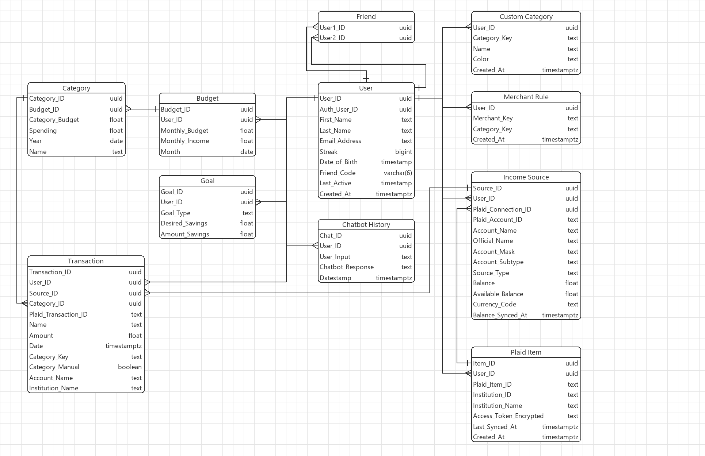

# App Summary:

College students often struggle to budget effectively due to limited time, income, and motivation. To address this, we created a mobile-friendly budgeting app that automatically imports banking, credit card, and other financial transactions to make the budgeting process simpler. Additionally, we’ve implemented requested features such as investment account tracking, streaks, leaderboards, and AI assisted chatbot functionality. Our app is organized into five distinct domains: settings, home, summary, chat, and leaderboard. Under settings and home, the user can change basic configurations and quickly see their finances. Under summary, the user can view their spending and savings rates broken down by category with customizable data visualizations. Under chat, the user can interact with an AI chatbot to obtain personalized insights about their spending habits and goals. Finally, the leaderboard allows the user to compete with their friends to save the highest percentage of their income, building community and fun accountability into the app.

## Current status

| Area | State |
| --- | --- |
| Sign-up, sign-in, sessions | Working. Supabase Auth, HttpOnly session cookie. |
| Bank connections | Working in Plaid Sandbox: link, balances, disconnect. |
| Transactions | Working. Imported from Plaid (up to 24 months) and saved to Supabase; users can also add their own by hand. |
| Automatic categorization | Working. Merchant rules, then Plaid's hints, then Other; users can add categories and re-categorize. |
| Month views | Working. Details has a month switcher; Home shows a real six-month trend. |
| Home, Details | Real data once a bank is linked or a transaction is added; sample data before that. |
| Budget, goals, preferences, streak | Prototype. Still stored in the browser (`localStorage`). |
| Friends, leaderboard | The friend code is real; friends and points are sample data. |
| Chat | Canned replies built from the current month's spending. Not AI-powered yet. |

## ERD:



The diagram matches `supabase/schema.sql`: a line with a bar is the "one" side of a relationship, and a crow's foot is the "many" side. `Custom Category`, `Merchant Rule`, `Plaid Item`, and the extra `Transaction` columns are new since the first version.

Notes on the spending tables:

- `Transaction.category_key` holds either a built-in category id (`housing`, `food`, `transport`, `utilities`, `education`, `personal`, `other`) or a key from `Custom Category`. It is deliberately not a foreign key, so built-in categories need no rows.
- A `Transaction` with no `plaid_transaction_id` is a manual entry the user typed in. Bank refreshes never touch those rows.
- The older `Category` and `Budget` tables are not used by the app yet. Budgets, goals, and category limits still live in browser storage.
- Every table is protected by Row Level Security. The server writes to the new tables with the Supabase secret key, and signed-in users can only read their own rows.

## Tech Stack:

For our front end, we use HTML, CSS, and TypeScript with Vite. TypeScript adds static checking while keeping the app framework-free and easy to work on as a team.

On the back end, we’re using Supabase. It gives us a solid place that will handle a lot of the backend work that is usually complex, allowing us to do solid backend work. It allows us to build the system fast and focus on the actual features of our product without getting slowed down by excessive configuration.

A small Node.js server sits between the browser and Supabase. It keeps all credentials on the server, talks to Plaid for bank data, and exposes the `/api` endpoints listed below. Code shared by the browser and the server (calendar-month math) lives in `src/shared/`.

This combination of HTML, CSS, TypeScript, and Supabase allows us to focus on building the app without introducing an additional front-end framework.

## Development Setup

Follow these steps to run a fresh clone locally.

### Prerequisites

- Git, to clone the repository.
- Node.js **20.19 or newer** (or **22.12 or newer**) and npm. Install the current Node.js LTS release from [nodejs.org](https://nodejs.org/) if Node.js is not installed; npm is included with Node.js.
- A Supabase project, for sign-up, sign-in, and data storage.
- A free [Plaid](https://dashboard.plaid.com/signup) account with Sandbox keys, to connect test banks.

### Start the app

Check that Node.js and npm are available in a terminal:

```powershell
node --version
npm --version
```

If either command is not found, install Node.js LTS as described above, then reopen the terminal.

1. Clone the repository and enter its directory:

   ```powershell
   git clone https://github.com/jacksonmclean326/is_core_project.git
   cd is_core_project
   ```

2. Create a local `.env` file next to `.example.env` (copy `.example.env` if helpful).

3. Fill in `.env`. Keep all secret keys in the backend environment only. `.env` is ignored by Git and should stay local.

   | Variable | Where to get it |
   | --- | --- |
   | `SUPABASE_URL` | Supabase project URL (`https://<project>.supabase.co`, without a path). |
   | `SUPABASE_PUBLISHABLE_KEY` | Supabase **Project Settings → API Keys**. |
   | `SUPABASE_SECRET_KEY` | The Supabase secret (service role) key. Server only. |
   | `CLIENT_ID`, `PLAID_SECRET` | Plaid Dashboard **Developers → Keys** (use the Sandbox secret). |
   | `PLAID_MODE` | `sandbox` (the default) or `production`. |
   | `PLAID_TOKEN_ENCRYPTION_KEY` | A 32-byte key, generated with the command below. |
   | `SUPABASE_JWKS_URL` | Not used by the app. Leave it blank. |

   Generate the encryption key with:

   ```powershell
   node -e "console.log(require('node:crypto').randomBytes(32).toString('base64'))"
   ```

   Back up the encryption key securely; changing it without first re-encrypting saved Plaid tokens will require users to reconnect their institutions.

4. Set up the database.

   - **Fresh Supabase project:** run `supabase/schema.sql` with `psql` (it contains a `psql`-only line, so the SQL Editor cannot run it).
   - **Existing project:** open the Supabase **SQL Editor** and run each file in `supabase/migrations/`, in date order. Every file is safe to run twice.

5. Install the exact dependency versions from the lockfile:

   ```powershell
   npm ci
   ```

6. Start the server:

   ```powershell
   npm start
   ```

7. Open `http://localhost:3000` (or the port configured with `PORT`). `npm start` serves the built pages and API from the Node.js server. For frontend development with Vite, run `npm run server` and `npm run dev` in separate terminals, then open the URL Vite prints; it proxies `/api` requests to the backend on port `3000`.

In Supabase **Authentication** settings, enable email/password sign-in and add both `http://localhost:5173` (Vite development) and `http://localhost:3000` (`npm start`) to the allowed redirect URLs. Set the Site URL to the address you use locally. If email confirmation is enabled, confirm the address after signing up before signing in.

The Node.js server is the only part of the app that connects to Supabase. It handles account creation, sign-in, session checks, sign-out, account details, friend-code lookups, bank connections, transactions, and categories through HTTP endpoints. The browser sends same-origin `/api` requests and receives an HttpOnly session cookie; it does not include Supabase credentials. Plaid connection records, encrypted access tokens, transactions, and categories are managed server-side using the Supabase secret key, so every query is filtered to the signed-in user. Keep direct table access to `Plaid Item` restricted to the server's service role; review its grants and row-level security policies before deployment.

The server serves the pages at `/auth`, `/home`, `/details`, `/chat`, `/leaderboard`, and `/settings`. These are regular GET routes with no hash fragments; signed-out visitors are redirected to `/auth`. The Details page also accepts `?month=YYYY-MM`.

For the Friends page's dynamic friend code, the Supabase project must have a `public."User"` profile row whose `user_id` matches the Auth user ID and whose `friend_code` is a unique six-character code. The table's Row Level Security policy must allow authenticated users to select their own profile row (for example, `auth.uid() = user_id`). The sign-up form sends `first_name`, `last_name`, and `full_name` as Auth user metadata; configure the Auth-to-profile trigger to copy the names and generate the friend code in the database.

### Plaid bank connections

Plaid starts in Sandbox, which only offers fake test banks. In the bank login popup use `user_transactions_dynamic` with password `pass_good` for about three months of realistic transactions, or `user_good` / `pass_good` for about one month. Real banks need Plaid production access.

The web client loads Plaid Link from Plaid's CDN; the server creates Link tokens, exchanges public tokens, encrypts access tokens with AES-256-GCM, and stores them only in the server-managed Plaid Item table. Account metadata and cached balances are synced with Plaid's `/accounts/get` endpoint when Settings opens. The Home page reads the saved linked-account count without triggering a sync. Cached balances are not guaranteed to be real-time.

Plaid requires at least one product for new Link sessions, and this integration uses Transactions. Plaid pulls the last ~30 days first and fills in older months a few minutes later, so right after linking, older months can look incomplete; the app shows a notice during the first 10 minutes. Plaid's product access and any applicable pricing still apply, especially before changing `PLAID_MODE` to `production`; review your Plaid Dashboard access and pricing before production use.

### Spending data

**Transactions.** `GET /api/transactions` reads a bank's transactions from Plaid on request, categorizes them, and saves them to the `Transaction` table. Income, refunds, transfers, and credit-card payments are skipped, so the numbers show spending only.

**Months.** Everything is organized by calendar month. `?month=YYYY-MM` selects the month (default: the current one, up to 24 months back), and `&history=N` adds per-month totals for the N months before it, which Home uses for its six-month trend. The month math (month lengths, leap years, year rollover, weekdays) is in `src/shared/months.ts` and works on `YYYY-MM-DD` text, so results never depend on the computer's time zone. The current month stops at today.

**Categories.** Each transaction gets exactly one category. The first rule that applies wins:

1. A category the user picked for that transaction.
2. A remembered merchant rule (from moving a transaction with "move all from the same merchant" checked).
3. Merchant keyword rules in `src/server/categorize.ts` (for example, "Uber" is Transport and "Uber Eats" is Food).
4. Plaid's own category hints.
5. Other.

Users can add their own categories (up to 12, names up to 24 characters), rename and hide any category, and delete their own. Deleting a custom category moves its transactions to Other. Built-in categories can be renamed and hidden but not deleted.

**Manual transactions.** On the Details page, **Add** records a transaction by hand, and a category's transaction list has **Edit** and **Delete** for those entries. They are stored in the same table with no Plaid ID, count toward totals, charts, and trends, and work without a linked bank (the first entry replaces the sample data). Amounts must be positive, and dates can be at most tomorrow and 24 months back. A bank refresh never changes or deletes them, and merchant rules apply to bank transactions only.

### API

All endpoints require a signed-in session (except sign-up and sign-in) and return JSON.

| Endpoint | Purpose |
| --- | --- |
| `POST /api/auth/signup`, `/signin`, `/signout`, `GET /api/auth/session` | Account and session handling. |
| `GET /api/account`, `GET /api/friend-code` | Account details and the friend code. |
| `POST /api/plaid/link-token`, `/exchange` | Start and finish a bank connection. |
| `GET /api/plaid/accounts`, `POST /api/plaid/accounts/refresh`, `DELETE /api/plaid/items/:id` | Linked accounts, balance refresh, disconnect. |
| `GET /api/transactions?month=YYYY-MM&history=N` | One month of categorized transactions, plus optional monthly summaries and the user's custom categories. |
| `PUT /api/transactions/category` | Move a bank transaction (`transactionId`, `category`, optional `applyToMerchant`). |
| `POST /api/transactions/manual`, `PATCH`/`DELETE /api/transactions/manual/:id` | Add, edit, delete a manual transaction. |
| `GET`/`POST /api/categories`, `PATCH`/`DELETE /api/categories/:key` | List, create, rename, delete custom categories. |

### Build and run the production server

Use these commands when needed:

```powershell
npm start
```

`npm start` first runs the full build: it type-checks the frontend and backend TypeScript, builds the frontend, and compiles the backend into `dist/server/`. It then serves the frontend and backend together on port `3000` (or set `PORT`). For production HTTPS deployments, set `NODE_ENV=production` so the session cookie is marked `Secure`; deploy the Node.js server rather than the static `dist/` folder alone.

### Server-side code

`src/server/index.ts` starts the backend, and `src/server/router.ts` connects HTTP requests to the API and web handlers. API routes are grouped under `src/server/api/` (`auth`, `account`, `plaid`, `transactions`, `manual-transactions`, `categories`); authentication, Plaid, HTTP helpers, and static/page serving each have their own modules. `src/server/categorize.ts` holds the automatic categorization rules, and `src/shared/months.ts` holds the calendar math used by both the server and the browser. Browser code in `src/app/` calls the API. Development runs the TypeScript backend directly with `tsx` and requires the separate backend and Vite terminals described above. Production rebuilds and then runs the compiled server from `dist/server/` whenever you run `npm start`. Server-side sessions are held in memory, so restarting the backend signs users out; use a shared session store before running multiple backend instances.

Budgets, goals, category limits, and preferences are still stored in the browser and are not yet saved per user in Supabase. Bank connections, transactions, custom categories, and merchant rules are stored per user in Supabase as described above. Client-side route guards are for navigation only and are not data security.

Each app page lives in its own folder under `src/app/pages/` and keeps its HTML, CSS, and TypeScript together, named after the folder. Shared styles are in `src/app/global.css`; shared browser state and the transaction/category dialogs are in `src/app/core.ts`.

## Tests

- `npm test` runs the unit tests (categorizer, month math, validation, summaries). No network or database needed.
- `npm run typecheck` type-checks the browser and server code.
- Integration tests use the real Plaid Sandbox and Supabase, so they need a filled-in `.env` and the server running (`npm start`). Each creates throwaway users and deletes everything it created:

  ```powershell
  node --env-file=.env --import tsx tests/e2e.integration.mts          # months, summaries, storage
  node --env-file=.env --import tsx tests/categories.integration.mts   # custom categories, re-categorizing
  node --env-file=.env --import tsx tests/manual.integration.mts       # manual transactions
  ```

## Verifying the Vertical Slice:

Run `npm start`, create an account from the sign-in screen, and confirm the email if email confirmations are enabled in Supabase. Then sign in, refresh to verify the session persists, and use **Sign out** to return to the sign-in screen.

To check spending data:

1. In **Settings**, connect a Sandbox bank (`user_transactions_dynamic` / `pass_good`).
2. Open **Details**. Use the month arrows; the label, chart, and totals should change together, and `?month=` should appear in the address bar.
3. Click a category, move a transaction to another category, and open **Edit** on the summary to add a category of your own.
4. Use **Add** to enter a transaction by hand, then edit and delete it from its category's list.
5. Open **Home** and confirm today's date and a six-month trend ending with the current month.

## Known limitations

- Budgets, goals, and category limits are not saved per user yet, so they do not follow someone to another browser.
- Friends and leaderboard points are sample data, and the chat does not use an AI model yet.
- The Home trend and Details totals compare spending against one monthly budget; there are no per-month budgets.
- Transactions are spending only. Income and refunds are not tracked.
- Some interest, fee, and tax charges land in Other because there is no category for them.
